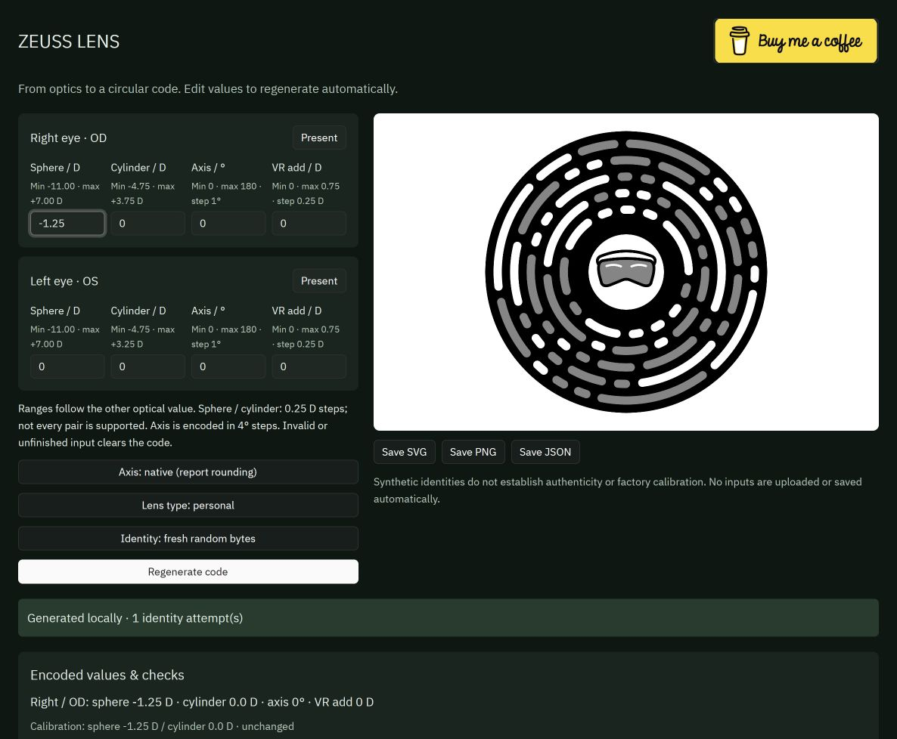
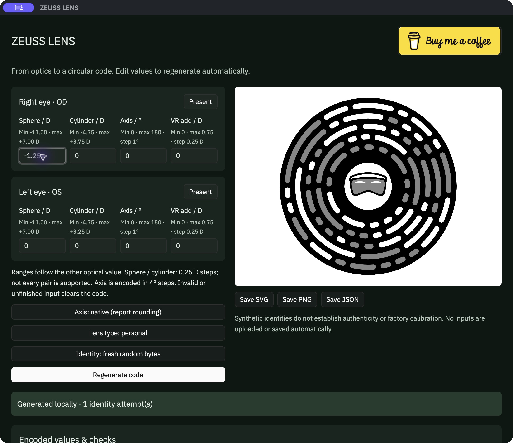

# ZEUSS LENS

A Rust and GPUI optical-code generator for people using third-party lenses with Apple Vision Pro. One interface runs on macOS, Windows, Linux, and directly in your browser through WebAssembly.

[Open ZEUSS LENS](https://zeuss-lens.pages.dev/) · [Desktop downloads](https://github.com/stacklikemind/ZEUSS-LENS/releases) · [How code generation works](docs/CODE_GENERATION.md)

**Generate a code online:** open [https://zeuss-lens.pages.dev/](https://zeuss-lens.pages.dev/), enter your lens values, and the code is generated automatically in your browser. No download or installation is required.





## Why this exists

ZEUSS LENS was created for people who cannot buy official ZEISS Optical Inserts in their country and therefore rely on third-party lenses. Access to suitable lenses should not depend on where someone lives. [ZEISS describes its market availability and directs customers to country-specific purchasing options](https://www.zeiss.com/vision-care/us/zeiss-optical-inserts.html).

Apple's published setup flow pairs ZEISS inserts using their supplied code. Apple has not published an open third-party lens code-generation interface in the documentation reviewed for this project. This project provides an independent Rust implementation to explore that compatibility gap.

A missing or incorrect pairing code prevents the normal insert-pairing workflow and can leave users unable to complete the corresponding eye-tracking setup correctly. Apple requires insert pairing before completing eye setup and recommends redoing eye setup when changing vision correction. That explains the problem this project aims to address; it does not prove that a generated code guarantees correct calibration with every third-party lens. See [Apple's pairing instructions](https://support.apple.com/en-us/117731) and [eye setup guidance](https://support.apple.com/en-us/118503).

This is an independent, experimental project, unaffiliated with Apple or ZEISS. Successful symbol checks do not establish headset enrollment, factory calibration, or optical suitability.

## Use the app

Enter the prescription of your physical inserts for each eye. The **Code profile** preview shows your original values, the values that would be encoded, and the separate nominal calibration. Supported values regenerate automatically in the GPUI app. Incomplete inputs clear the previous code. Sphere and cylinder use 0.25 D steps; displayed table bounds depend on the other value and may have gaps.

When a pair does not fit the exact code table, the app can offer an optional **approximate profile**: keep the entered sphere and cylinder notation, then reduce cylinder magnitude toward zero to the nearest encodable value. Select **Try approximate profile** to generate it. Editing any input clears that selection and the old code. If no profile can preserve the sphere, generation remains unavailable. This is an experimental encoding convenience, not a validated optical match or a promise of improved tracking.

For example, entered **−11.00 / −3.75 × 170°** offers code values **−11.00 / −1.75 × 172°**, with nominal calibration **−10.00 / −1.75 D** when no VR add is supplied. The original prescription stays in the form and JSON export. Keep using physical inserts made for the actual prescription. After scanning, complete eye setup and check tracking in the center and near the edges; return to the previous setup if tracking is worse.

These are the **encoder's representable values**, not a published numeric limit for all Apple Vision Pro prescriptions. Apple directs users to [ZEISS's prescription guide](https://www.zeiss.com/vision-care/us/zeiss-optical-inserts/prescription-guide.html) to check whether an actual prescription can be supplied as optical inserts. Code generation cannot establish lens eligibility or clinical suitability.

Save the result as SVG, PNG, or JSON. JSON exports include the entered and encoded values, calibration transformations, warnings, and bit checks. Processing stays on your device; inputs are not uploaded or stored automatically.

Desktop packages cover Apple Silicon and Intel Macs, Windows x64, and Linux x64. Extract the macOS or Windows ZIP and double-click the app. On Linux, enable executable permission on the AppImage and open it. Builds are not commercially signed or notarized.

| Download | Platform |
| --- | --- |
| [Apple Silicon Mac](https://github.com/stacklikemind/ZEUSS-LENS/releases/download/v0.2.0/zeuss-lens-macos-arm64.zip) | macOS ARM64 |
| [Intel Mac](https://github.com/stacklikemind/ZEUSS-LENS/releases/download/v0.2.0/zeuss-lens-macos-x86_64.zip) | macOS x86-64; cross-compiled, not locally executed |
| [Windows](https://github.com/stacklikemind/ZEUSS-LENS/releases/download/v0.2.0/zeuss-lens-windows-amd64.zip) | Windows x64 |
| [Linux AppImage](https://github.com/stacklikemind/ZEUSS-LENS/releases/download/v0.2.0/zeuss-lens-linux-x86_64.AppImage) | Linux x64 |
| [Browser bundle](https://github.com/stacklikemind/ZEUSS-LENS/releases/download/v0.2.0/zeuss-lens-gpui-web.zip) | Self-hosted WebAssembly; serve over HTTP(S) |

See [native and WASM build instructions](docs/GPUI.md), [Cloudflare deployment](docs/DEPLOYMENT.md), and the [format specification](spec/FORMAT.md). The [lightweight HTML frontend](https://zeuss-lens.pages.dev/lightweight.html) is retained as an alternative; GPUI is the primary app.

<a href="https://www.buymeacoffee.com/stacklikemind" target="_blank"></a>

## Build the lightweight web app

Requirements: a current Rust toolchain, the `wasm32-unknown-unknown` target, and Node.js 18 or newer for the static server and adapter tests. The browser has no package dependencies, remote fonts, analytics, or external network requests. Cargo may need to download its Rust dependencies on the first build.

```sh
rustup target add wasm32-unknown-unknown
./scripts/build.sh
node scripts/serve.mjs
```

Open **http://localhost:8766/lightweight.html**. The server binds only to `127.0.0.1`, serves files from `web/`, and accepts only GET/HEAD requests. It performs no code generation. To change its port, use `PORT=8767 node scripts/serve.mjs`.

`build.sh` builds the release Rust library for WebAssembly and copies it to `web/vision_code.wasm`. There is no `wasm-pack`, `wasm-bindgen` CLI, npm install, or Apple SDK step. Generated WASM and Cargo's `target/` directory are ignored by Git. Keep the server running while using the page; opening `index.html` directly as a `file:` URL will not load the module reliably.

For public hosting, see [Cloudflare Pages deployment](docs/DEPLOYMENT.md). `./scripts/deploy.sh` tests, rebuilds, and deploys the static assets using Wrangler. The GitHub Actions workflow also tests the project and produces downloadable Pages assets; it does not automatically deploy.

## Browser behavior

- The initial example has two present zero-power lenses, axis 0°, explicit VR add 0, and personal lens type. A present zero-power lens is distinct from an absent eye.
- Sphere and cylinder must be exact 0.25 D increments. Exact encoding is the default; unsupported pairs offer a previewed cylinder-reduction profile only when explicitly selected. The chosen profile never changes during topology retries.
- Native axis policy permits the format's axis rounding and reports it. Exact policy rejects non-equivalent rounding. Axis 0° and 180° are equivalent. Positive cylinder inputs are canonicalized and displayed back in their original notation.
- Each eye has an explicit VR add of 0, +0.25, +0.50, or +0.75 D. No age-based add is inferred.
- Web Crypto creates a new 80-bit synthetic identity for each generation attempt. Only a `TOPOLOGY` error can trigger a retry, with a maximum of 64 identities total and unchanged optics. Advanced fixed-identity mode accepts exactly 20 hexadecimal characters and tries once, preserving that identity even if topology fails.
- Entered values, encoded values, rounding, warnings, and calibration adjustments are shown separately. In the lightweight frontend, changing an input marks its old result as stale; GPUI regenerates automatically.
- SVG exports preserve the full 880 × 880 geometry and white margin. PNG exports render that complete SVG onto a white 1760 × 1760 canvas. JSON reports include the exact request, synthetic identity, result, validation, and attempt count. No inputs or identities are saved to browser storage.

The page's validation labels refer only to in-memory symbol bits: payload round trip, Reed–Solomon syndromes, checksums, and redundant colors. They are not raster, native runtime, camera, or hardware tests.

## Native CLI and JSON API

The CLI reads one JSON request from standard input and emits one JSON response:

```sh
printf '%s\n' '{"op":"generate","left":{"sphere":0,"cylinder":0,"axis":0,"rx_offset_id":0},"right":{"sphere":0,"cylinder":0,"axis":0,"rx_offset_id":0},"axis_policy":"native","secret_hex":"00010203040506070809"}' | cargo run --release --bin vision-code
```

The example identity is synthetic and fixed for reproducibility. The native API requires the caller to supply an identity; the browser provides fresh random bytes.

Operations:

| `op` | Inputs | Purpose |
| --- | --- | --- |
| `generate` | `left`, `right`, `secret_hex`; optional `axis_policy`, `diopter_policy`, `lens_type` | Encode version 5 optical inputs and render a circular symbol. |
| `encode_payload` | `payload_hex`: exactly 32 hexadecimal characters | Render exactly 16 payload bytes without interpreting their version. |
| `decode_symbol` | `gaps`: 128 binary values; `colors`: one binary value per visible arc | Validate/decode known symbol bits. This is not an image or camera scanner. |
| `config` | No additional inputs | Return supported parameters and optical pairs. |
| `review` | `left`, `right`; optional `axis_policy` | Preview both eyes, optional cylinder reduction, and nominal calibration without generating an identity or symbol. |

Each eye is `{ "sphere": number, "cylinder": number, "axis": integer, "rx_offset_id": integer }`. Missing/null eyes are absent; at least one eye must be present. Offset defaults to 0, axis policy to `native`, diopter policy to `exact`, and lens type to 3 (personal). Explicit `diopter_policy: "reduce_cylinder"` preserves the entered sphere and reduces cylinder magnitude only when the original pair is unsupported. Result `profile_adjustments` records each cylinder change; `entered` retains the original values. Exact axis policy still applies to an approximate profile. Lens types 1 (reader) and 2 (developer) are also supported.

Success is `{ "ok": true, "result": { ... } }`; failure is `{ "ok": false, "error": { "code": "...", "message": "..." } }`. Only the error code `TOPOLOGY` is retryable with a new identity. Generation results include `diopter_policy`, `profile_adjustments`, `svg`, `payload_hex`, `outer_hex`, `gaps`, `colors`, `inverted`, `metadata`, `entered`, `encoded`, `calibration`, `warnings`, and `validation`. The complete behavior is specified in [spec/FORMAT.md](spec/FORMAT.md).

## Raw WebAssembly ABI

The module exports `memory` and the following functions:

```text
vc_abi_version() -> u32                 // 1
vc_alloc(length: u32) -> u32            // caller-owned input pointer
vc_free(pointer: u32, length: u32)      // free with the original length
vc_process(pointer: u32, length: u32) -> u32  // module-owned response pointer
vc_response_len() -> u32                // response byte length
```

Encode request JSON as UTF-8, limited to 65,536 bytes. Allocate and write the input, call `vc_process`, then read exactly `vc_response_len()` UTF-8 response bytes. The response remains valid only until the next process call. Free the input with the same pointer and length. Memory can grow during allocation and processing; obtain a fresh typed-array view after either call. `web/engine.mjs` contains the small reusable browser/Node adapter.

## Tests

```sh
cargo test
./scripts/build.sh
node scripts/test-browser.mjs
```

The browser-adapter tests verify that topology retries are bounded, non-topology errors do not retry, fixed identities stay fixed, optics are unchanged, and memory growth cannot invalidate a cached view. When the built WASM exists, the same script also checks every synthetic symbol fixture through the ABI and decodes successful symbols back to their payloads. Missing WASM is reported as a skipped integration step, not a passing WASM test.

Manual browser checks should cover native versus exact axis handling, both-eye absence, unsupported optical pairs, calibration clamping/unavailable limits, stale previews after edits, all three exports, and narrow viewport layout. Native tests and browser bit checks alone provide no evidence of hardware compatibility.

## Limits

Known limitations include a finite optical table, axis quantization, calibration sphere limits and transformations, and synthetic identities with no factory-record provisioning. Some encodable pairs have no known calibration-limit row; the engine reports calibration unavailable instead of inventing limits. The independent center illustration is not a source logo. The shipped tool has no Apple runtime dependency and no camera scanner. Successful symbol-bit validation does not guarantee headset enrollment, manufacturer authenticity, factory calibration, or optical suitability.

## Recorded verification

The GPUI frontend passed four adapter tests and native encoder/PNG smoke tests. Automatic regeneration was checked in the browser and macOS app: changing a sphere value changed the symbol and encoded report without pressing Generate. The deployed WASM matched the locally tested build byte for byte. Desktop build results are available in [GitHub Actions](https://github.com/stacklikemind/ZEUSS-LENS/actions/workflows/desktop.yml).

The delivered version passed 14 Rust tests, including 49,725 supported prescription/axis combinations. Separate validation checks passed 64 held-out symbols, 24 raster comparisons, and 64 additional prescription cases. Browser SVG/PNG/JSON exports were created and their payloads cross-checked. A temporary standalone copy built for WASM and passed tests with Cargo offline/locked using cached dependencies.

Evidence: [interoperability report](spec/INTEROPERABILITY_REPORT.json), [standalone build report](spec/STANDALONE_BUILD_REPORT.json), [browser QA](spec/BROWSER_QA.md). These are development results, not a hardware-enrollment guarantee. Clippy was unavailable in the installed toolchain.
