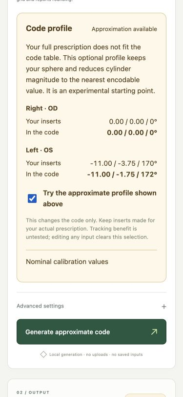

# Optional code profile verification

Checked on macOS with the Rust engine, native GPUI build, shared GPUI browser build, and lightweight HTML interface.

The example is a synthetic test based on a public prescription report: entered sphere −11.00 D, cylinder −3.75 D, axis 170°. The offered code profile is −11.00 / −1.75 × 172°; its reconstructed nominal calibration is −10.00 / −1.75 D at zero VR add. These checks do not establish headset acceptance or improved tracking.

## Automated checks

- `cargo test --locked`: 18 tests pass, including the existing 49,725 prescription/axis combinations and all 1,105 exact pairs remaining unchanged with the optional policy.
- `cargo test --manifest-path desktop/Cargo.toml --locked --lib`: five tests pass, including preview/export agreement and retention of original input values.
- `./scripts/build.sh` and `node scripts/test-browser.mjs`: WASM builds; approximation requires an explicit policy, preview and generation agree, exact-axis rejection is preserved, unavailable profiles fail, and all 16 symbol fixtures and successful decode round trips pass.
- `./scripts/build-gpui-web.sh`: shared browser UI builds.
- Native release build and `zeuss-lens --self-test`: embedded encoder, payload round trip and PNG export pass.

## Browser observations

In GPUI, entering the unsupported example clears the code and disables exports. The profile shows original values, candidate values, and nominal calibration. Selecting **Try approximate profile** generates a code and enables exports. Its downloaded JSON retains the actual prescription, candidate cylinder, nominal sphere, selected policy and structured cylinder adjustment.

In the lightweight interface, the same preview requires an unchecked option before generation. Editing cylinder after generation clears the selection, preview and export availability. At a 375 px viewport, the profile wraps without horizontal document overflow. Both-eye absence and exact-axis rejection remain unavailable through the engine preview.

Native GUI interaction, Windows/Linux builds, camera scanning, and physical headset pairing were not tested in this change. Native model/PNG smoke checks and browser interaction with the shared GPUI view cover separate parts of the implementation.
